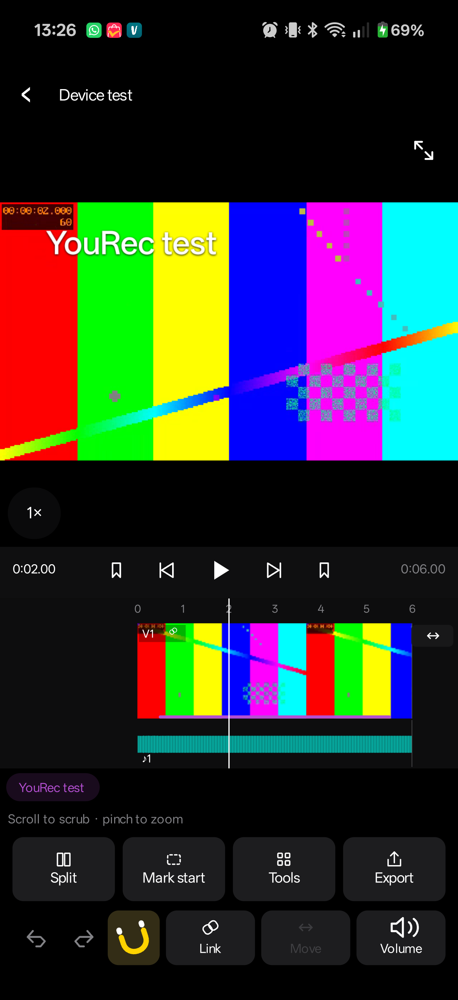
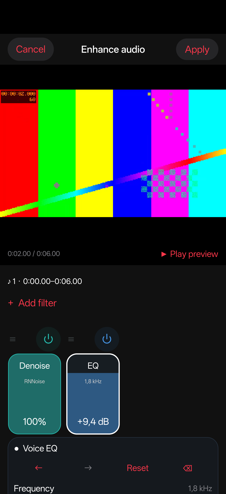
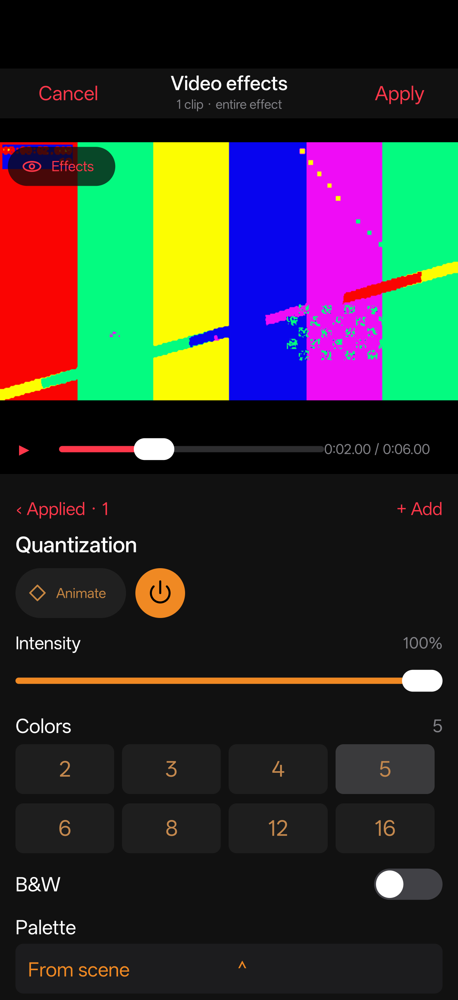

<p align="center">
  
</p>

**YouRec** is an Android video recorder and editor with local audio processing
and captions. Record, pause, change cameras, edit and export from the same app.
Your recordings stay on your phone.

The interface is native Kotlin and Android Canvas. Camera2 and Android media
APIs handle capture and export; C11 handles image processing, stabilization and
the bridges to external inference runtimes.

## Screenshots

| Editor | Audio | Video effects |
| --- | --- | --- |
|  |  |  |

These captures use synthetic test media.

## What you can do

* Pause and resume recording, switch cameras, control zoom speed, and lock focus.
* Compose simultaneous front/rear video and record 10-bit HLG on supported hardware.
* Select a microphone and keep an ordered list of preferred inputs.
* Split, copy, paste, move and trim clips, with ranges, undo and redo.
* Add text, images, transitions, color effects, framing and stabilization.
* Shape audio with ordered filters, voice isolation and neural restoration.
* Generate editable captions locally with Qwen ASR.
* Export H.264 video with AAC audio to Android's media library.

Edits are non-destructive. Recording appends to the current project unless you
choose **Start new project**. Portrait and landscape have separate layouts.

## Start here

YouRec requires **Android 9 or later and an ARM64 device**. Build the APK below,
install it, and allow camera and microphone access when recording. Open Projects
to create a project, import video, continue recording or return to editing.
The page also opens the privacy policy and Recently deleted, where projects can
be restored or permanently removed.

Ordinary recording and editing work without downloading a model. Captions and
neural audio effects offer their model downloads when needed. See the
[recording guide](docs/RECORDING.md) and [editing guide](docs/EDITING.md).

## Models

| Model | Use | Approximate download |
| --- | --- | --- |
| RNNoise | Legacy voice isolation | Included |
| PPHumanSeg | Keep people in color | Included, 5.9 MB |
| DeepFilterNet3 | Noise reduction | 8.6 MB |
| VoiceFixer | Studio restoration | 415 MB |
| LavaSR v2 | Speech detail | 56 MB |
| Qwen3 ASR · 0.6B | Offline captions | 1.9 GB |

Inference runs on the CPU through C APIs. Downloads are separate from your
recordings. [MODELS.md](docs/MODELS.md) explains processing, storage and limits;
file pins and checksums are in [data/models.json](data/models.json).

## Build

Use JDK 17 or later, Android SDK 37, NDK 28.2.13676358, CMake 3.31.6 and Python 3.12.

```sh
python3 tools/prepare-runtimes.py
python3 tools/prepare-person.py
./tools/build.sh :app:assembleDebug
```

The APK is written to `app/build/outputs/apk/debug/app-debug.apk`.
The [build guide](docs/BUILD.md) covers SDK paths, runtime preparation and the
alternative compiler script. The [release guide](docs/RELEASING.md) covers signing.

## Privacy

Recording, editing, audio processing and transcription run locally. The app has
no advertising or analytics SDK. Projects, settings, downloaded models and
processing caches stay in Android app storage; exports go to `Movies/YouRec`.

Model downloads contact GitHub, Hugging Face and their delivery providers.
Recordings and transcripts are not part of those requests. Sharing or importing
media uses the Android picker and the app you choose. Read the
[privacy notes](docs/PRIVACY.md).

## Status and documentation

YouRec is development software. Camera and microphone support follows Android's
reported capabilities rather than a phone-model list. Physical device testing
has covered the attached OnePlus 15; other phones and accessories still need
validation. Effect quality and processing time vary with the media and hardware.

* [Recording and microphones](docs/RECORDING.md)
* [Editing and export](docs/EDITING.md)
* [Models and inference](docs/MODELS.md)
* [Building](docs/BUILD.md), [testing](docs/TESTING.md), and [releasing](docs/RELEASING.md)

## Credits

YouRec uses [RNNoise](https://github.com/xiph/rnnoise),
[Qwen ASR](https://github.com/antirez/qwen-asr), and
[ONNX Runtime](https://github.com/microsoft/onnxruntime). Their versions and
source checksums are pinned in [runtimes.json](runtimes.json).

Models, runtime libraries and supplied artwork retain their own rights and
notices. See [THIRD_PARTY_NOTICES.md](THIRD_PARTY_NOTICES.md) and the
[bundled licenses](app/src/main/assets/licenses).

## Contributing

Read [CONTRIBUTING.md](CONTRIBUTING.md) for build checks, device tests and useful
bug reports. Keep application code in Kotlin or C11 and call external inference
implementations through their C APIs.
