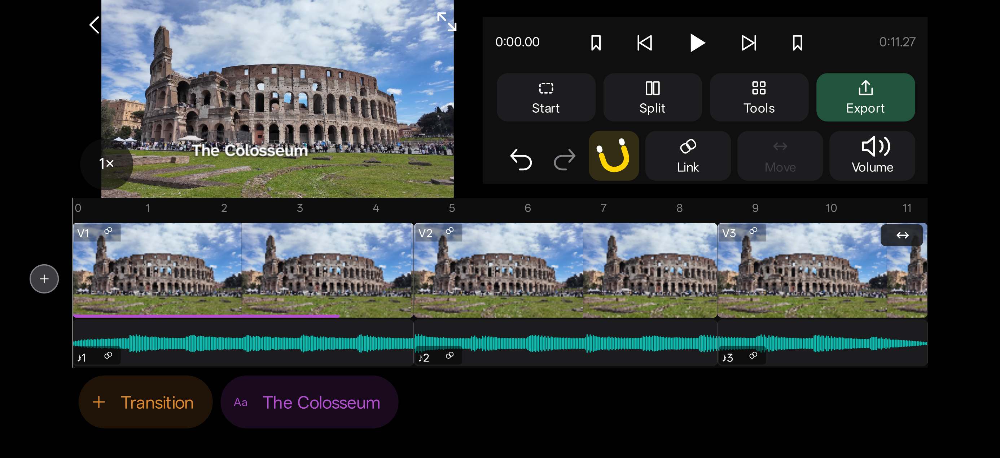
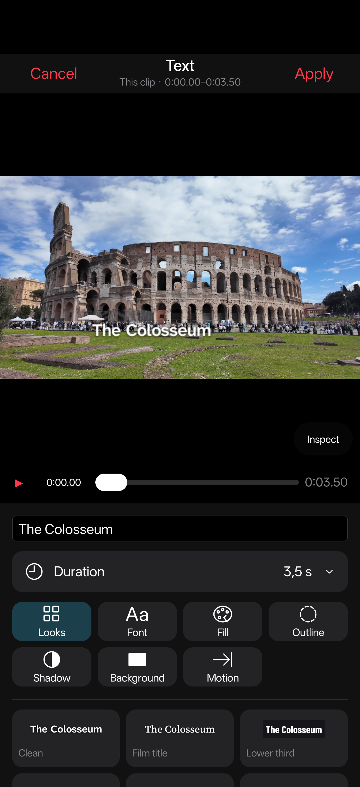
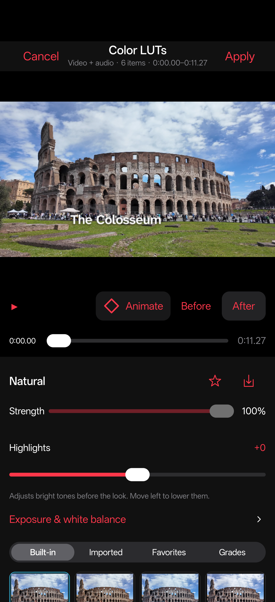

<p align="center">
  
</p>

# MyRec

MyRec is a video recorder and editor for Android. Record a take, pause, change
cameras, cut the parts you do not want, fix the sound, and export. The recordings
and the work stay on your phone.

The project follows [YouRec for iPhone](https://github.com/antirez/YouRecApp),
by Salvatore Sanfilippo (antirez). This is an independent Android implementation.
Features and processing are being aligned with the released iPhone source.
The guides describe current behavior and limits.

## Editing a video in MyRec

The timeline shows three clips of **The Colosseum**, with their audio underneath.
Use **Split** to make a cut, then reopen a title or transition from its timeline
chip to adjust it.

[](docs/screenshots/timeline.webp)

Use **Text** to place a title and set its duration. In **Color LUTs**, choose a
look and compare **Before** and **After** on the same frame.

<p align="center">
  <a href="docs/screenshots/text-overlay.webp"></a>
  <a href="docs/screenshots/color-luts.webp"></a>
</p>

[Footage credit and capture recipe](docs/screenshots/README.md).

## Recording and editing

You can switch cameras during a take, use a timed zoom, lock focus, and choose a
microphone. Phones with the required camera support can record front and rear
views together or capture 10-bit HLG video.

The editor has separate video and audio tracks. Split, trim, copy, paste, move,
and arrange clips; add text, images, transitions, color effects, and stabilization.
Timeline rows adjust automatically: sequential clips share a row, while overlaps
stay separately selectable. Move offers Selected only, With left, With right,
and Both sides; connected neighbors stop at gaps. Drag with edge snapping or
choose an exact cut, then Done or Cancel. Use Placement to arrange overlapping
pictures and change their front/back order. Long-press clips to extend a selection.
The Snap to cuts button remembers its setting. Scrubbing
snaps to nearby clip edges or bookmarks when released. Selection marks align to
cuts, quiet waveform points and the 30 fps edit grid; marks within a transition
align to its join.
Audio filters run in order. Clip speed preserves pitch; Volume offers separate
edge fades, and Censor audio replaces selected sound with a generated tone.
Captions and neural audio restoration work offline after their models have been
downloaded.

Edits leave the source files alone. Undo and redo survive reopening and project
switching; ordinary new recordings stay present through earlier editor undo.
Projects can be duplicated with independent media or transferred as checked ZIP
archives, including originals, history, overlays, and an OpenTimelineIO source
conform. Export writes H.264 SDR or, on capable devices, HEVC 10-bit HLG with
AAC audio to `Movies/MyRec`. HDR and Log editing use half-float working images;
HDR export requires a decoder and recording surface that preserve ten bits.

Color LUTs accepts project-owned 1D/3D CUBE files and explicit Apple Log
interpretation. Subtitles have transcript review and regrouping; Pauses saves
reviewable source cuts. Freeze Frame inserts a hold, and Dolly Zoom separates
a person from the background. Step Printing repeats and smears source frame
groups; Negative Strobe alternates positive and negative frames. Neural audio
prepares independent source channels
before timeline speed and gain. These paths still have differences from the
reference; see the editing guide for current limits.

Read the [recording guide](docs/RECORDING.md) and
[editing guide](docs/EDITING.md) for the controls and their limits.

Release 0.1.4 adds independent selfie preview/recording mirrors,
per-camera focus and zoom recall, front-light controls, and expanded Halation,
Noir and 16mm effects. Projects offers original-file review, verified bulk saves,
and recovery into a separate project. The cover picker saves composed JPEGs;
completed movie exports can be reused or saved again without re-encoding.
Stabilization adds timestamp-based Light/Standard/Strong levels with bounded
cropping and retained framing through cuts and trims.
Projects headings render correctly, and the editor accounts for camera cutouts
without a fixed portrait top gap. HDR checks the graphics driver
before interrupting a working SDR camera.

## Try it

You need Android 9 or later and an ARM64 device. Download the APK from
[release 0.1.4](https://github.com/Ninnix/MyRecApp/releases/tag/v0.1.4), install it, and
allow camera and microphone access when you start recording. Open Projects to
start a project, import video, or continue an existing recording.

The app is now named **MyRec**, with package `org.myrec.app`. It installs beside
the earlier `org.yourec.app` build. Android keeps their private projects, settings,
and downloaded models separate. There is no automatic migration yet; keep the
old app installed if it holds recordings or edits you need.

This is development software. Camera, microphone and HDR support depend on the
phone and its drivers. Full behavior and processing parity with iOS remains in
progress.

## Build

Use JDK 17+, Android SDK 37, NDK 28.2.13676358, CMake 3.31.6, and Python 3.12.

```sh
python3 scripts/prepare-runtimes.py
python3 scripts/prepare-person.py
./scripts/build.sh :app:assembleDebug
```

The APK is `app/build/outputs/apk/debug/app-debug.apk`.
See [Building](docs/BUILD.md) for SDK paths and
[Releasing](RELEASE.md) for signing.

The interface uses Kotlin and Android Canvas. Camera2 and Android media APIs
handle capture and export. C11 handles image processing, stabilization, and
calls to the external inference runtimes through their C APIs.

## Models

Ordinary recording and editing need no model download. The app offers downloads
when you choose captions or a neural audio filter.

| Model | Use | Download |
| --- | --- | --- |
| RNNoise | Voice isolation | Included |
| PPHumanSeg | Keep people in color | Included, 5.9 MB |
| DeepFilterNet3 | Noise reduction | 8.6 MB |
| VoiceFixer | Studio restoration | 415 MB |
| LavaSR v2 | Speech detail | 56 MB |
| Qwen3-ASR-0.6B | Captions | 1.9 GB |

Inference runs on the CPU. [Models](docs/MODELS.md) explains storage,
processing, and licenses. Downloads are pinned in [data/models.json](data/models.json).

## Privacy

The app has no advertising or analytics SDK. Recording, editing, audio
processing, and transcription run locally. Model downloads contact GitHub,
Hugging Face, and their delivery providers; they do not send recordings or
transcripts. Import and sharing use Android's picker and the app you choose.
Read the [privacy notes](PRIVACY.md).

## Acknowledgements

Thanks to **Salvatore Sanfilippo (antirez)** for
[YouRec](https://github.com/antirez/YouRecApp): the original camera and video
editor for iPhone, the design that started this project, and now the published
source that makes a careful Android port possible. MyRec is independently
maintained and is not an official YouRec release.

Thanks also to the authors of [RNNoise](https://github.com/xiph/rnnoise),
[Qwen ASR](https://github.com/antirez/qwen-asr),
[ONNX Runtime](https://github.com/microsoft/onnxruntime),
[DeepFilterNet](https://github.com/Rikorose/DeepFilterNet),
[LavaSR](https://github.com/ysharma3501/LavaSR),
[VoiceFixer](https://github.com/haoheliu/voicefixer), and
[PPHumanSeg](https://github.com/opencv/opencv_zoo/tree/main/models/human_segmentation_pphumanseg).
Runtime revisions are recorded in [runtimes.json](runtimes.json).

## Licenses and artwork

MyRec's application source code and documentation are released under the
[MIT License](LICENSE). It retains the copyright notices for Ninnix and the
MyRec contributors, and for Salvatore Sanfilippo's upstream work. The same
license is [bundled in the APK](app/src/main/assets/licenses/MyRec.txt).

YouRec's original code and documentation use the
[MIT License](https://github.com/antirez/YouRecApp/blob/faf1815e82e1f2d5f03034a583363d3c3af464a2/LICENSE).
That grant reserves the **YouRec name and icon** as branding. MyRec uses its own
name and newly generated hippopotamus artwork: a left-facing camera-like
silhouette, circular lens, and red recording eye. The MyRec name and icon are
also excluded from the source-code license. The complete upstream notice is
retained [in the app assets](app/src/main/assets/licenses/YouRec.txt).

Models and libraries keep their own licenses. VoiceFixer's code is MIT; its
published model checkpoints are CC BY 4.0. See
[THIRD_PARTY_NOTICES.md](THIRD_PARTY_NOTICES.md) and the
[bundled license texts](app/src/main/assets/licenses).

## Development

Read [CONTRIBUTING.md](CONTRIBUTING.md) and [Testing](docs/TESTING.md).
An optional local iOS checkout can live in `reference/YouRecApp/`; it is
excluded from Git. See [Building](docs/BUILD.md) for the reference commands.
